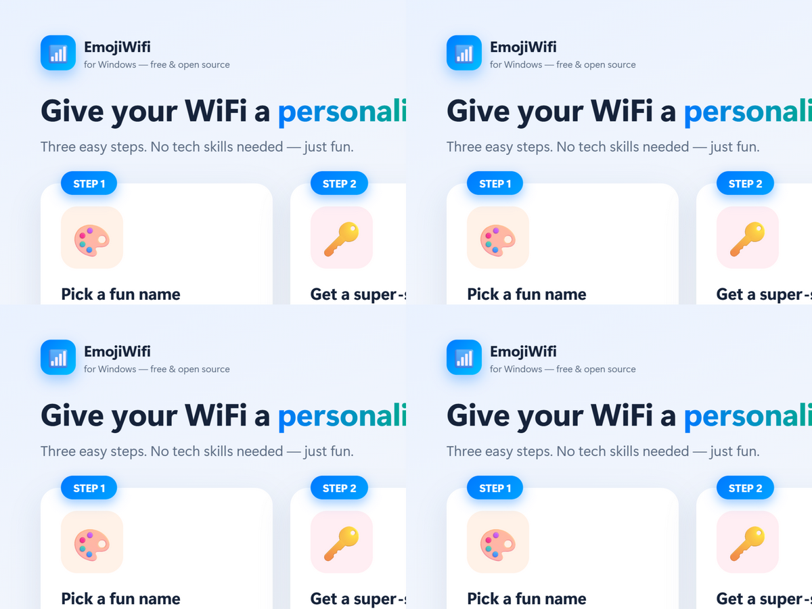
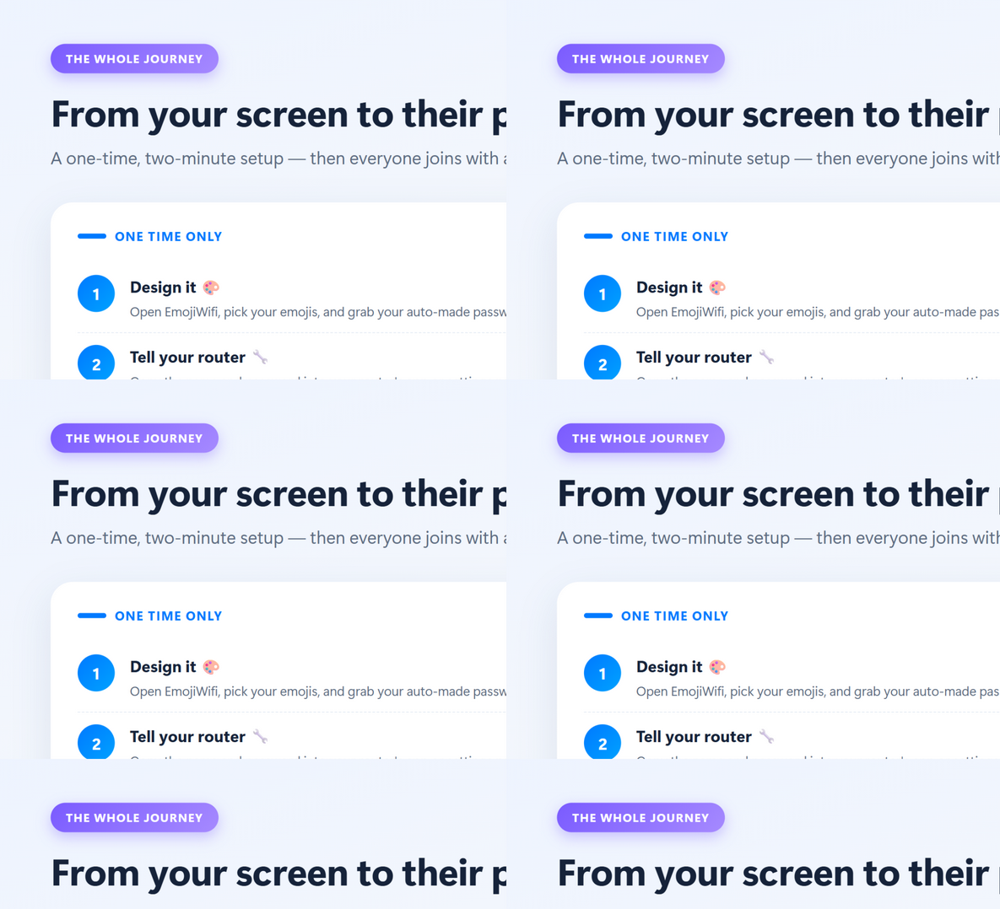
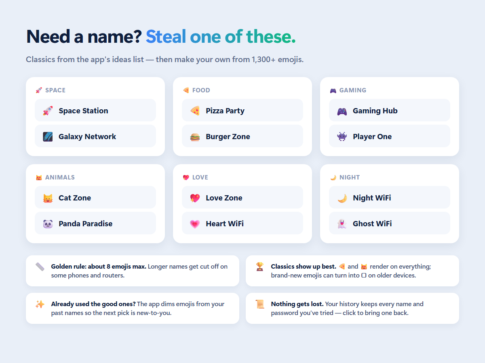
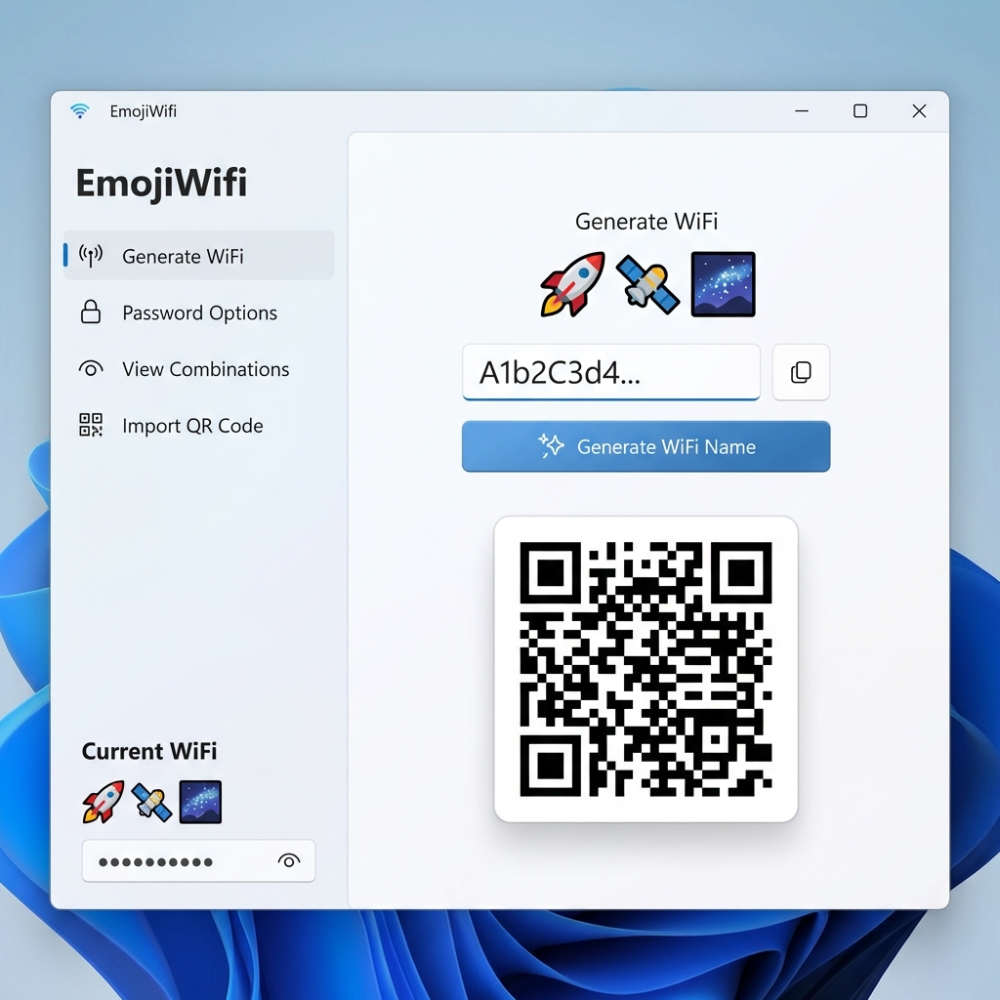

# 📶 EmojiWifi — give your WiFi a personality

Your WiFi name doesn't have to be `NETGEAR-5G` or `xfinity-1234`. It can be **🍕🍕🍕**.

EmojiWifi is a tiny free app for Windows that helps you dream up a fun emoji WiFi name, get a super-strong password to go with it, and turn it into a **QR code** that friends join by pointing their phone camera at it. No typing, no reading passwords out loud, no "is it a zero or the letter O?"

---

## 🚀 How it all works

**Once**, you set things up — it takes about two minutes. **Then**, everyone who visits just scans and they're online.

> **The one honest step other tools skip:** your WiFi name lives inside your router, so after you design it here, copy the name and password into your router's app or settings page (the login is usually printed on a sticker under the router). One time, done forever.

## 💡 Need a name? Steal one of these

Or type your own — any emojis you like. **Golden rule: keep it to about 8 emoji or fewer** so it shows up nicely on every phone and laptop.

## 🖥️ What the app looks like

A clean little window with everything on one screen: name ideas, your password, your QR code, and a history of setups you've used before.

## 📥 Get it (free, ~1 minute)

1. **Download** the zip from the [latest release](https://github.com/dparksports/emoji-wifi-windows/releases/latest). It's about **70 MB** — that's the app carrying its own engine inside, so you never have to install anything else (no ".NET", no runtimes, nothing).
2. **Unzip it** — right-click the file → *Extract All*.
3. **Double-click `EmojiWifiWindows.exe`**. That's the whole install — nothing else gets added to your computer.
4. First time? Windows may show a blue "Windows protected your PC" screen because we're a small free app without an expensive Microsoft certificate. Click **More info → Run anyway**. Our code is open — anyone can read it [right here](https://github.com/dparksports/emoji-wifi-windows).

> The first launch takes a few extra seconds (the app unpacks its engine once). After that it opens instantly.

## ❓ Questions people actually ask

**Does EmojiWifi change my router by itself?**
No. You design your name and password here, then paste them into your router once. We'd rather you know exactly what's happening to your internet.

**Can people join without typing anything?**
Yes — that's the whole point! iPhone and Android cameras understand WiFi QR codes natively. Point, tap the popup, online. 🎉

**I lost my WiFi password! 😱**
Open EmojiWifi → *Import QR Code* → pick any QR image you saved or screenshotted. Your name and password come right back.

**Is it safe? Where does my data go?**
Nowhere. The app works fully offline — no account, no sign-up, no tracking, nothing sent anywhere. Your names, passwords, and history stay in a little file on your own PC.

**What does it cost?**
Nothing. Free and open source (Apache 2.0 license).

**Windows only?**
For now, yes — Windows 10 or 11.

---

*Made for everyone whose WiFi deserves a better name.* 😊

**For developers:** built with .NET 8 + WPF in C#, tests and CI included — see [CHANGELOG.md](CHANGELOG.md) and the [source](https://github.com/dparksports/emoji-wifi-windows). Licensed under [Apache 2.0](LICENSE).
